  <a href="./README.md">Español</a> · <strong>English</strong>

  

<h1 align="center">Turning ideas into useful tools.</h1>

  <strong>Junior software development · Web and desktop applications · Local AI</strong> 
  Bogotá, Colombia · Remote first · Hybrid in Bogotá

  <a href="https://juanestebanherrerah.github.io/Portafolio/"><strong>Explore my portfolio ↗</strong></a>
  &nbsp; · &nbsp;
  <a href="https://www.linkedin.com/in/juan-esteban-herrera-herrera/">LinkedIn</a>
  &nbsp; · &nbsp;
  <a href="mailto:jehproyectos@gmail.com">Contact</a>

---

I'm **Juan Esteban Herrera Herrera**, a Professional Technician in Systems Support and IT and a Systems Engineering student at **CUN**.

I build applications to **organize information, process images and files, connect data and work with networks**. My experience comes from personal, university and collaborative projects.

## Tools I build

| Project | What you can explore |
| :--- | :--- |
| **[xIas](https://github.com/JuanEstebanHerreraH/xIas)** C# · .NET 8 · WPF · ONNX · Tesseract | Tables and documents in separate workspaces: OCR, cleaning, comparisons and local AI matching. Optional Google Sheets connectivity. **[Downloads ↗](https://github.com/JuanEstebanHerreraH/xIas/releases)** |
| **[Recorta](https://github.com/JuanEstebanHerreraH/Recorta)** React · TypeScript · Tauri · Transformers.js | Background removal with pretrained models, mask corrections, batch processing and exports with size and DPI controls. **[Downloads ↗](https://github.com/JuanEstebanHerreraH/Recorta/releases)** |
| **[Café Almacén](https://github.com/JuanEstebanHerreraH/Sistema_Trazabilidad_Cafetero)** Next.js · TypeScript · Supabase · PostgreSQL | Coffee traceability: producers, farms, lots, processes, inventory, customers and sales connected in one web platform. |
| **[Vlanets](https://github.com/JuanEstebanHerreraH/Vlanets)** Flutter · Dart · Windows · Android | IPv4/IPv6 subnetting, VLSM, VLAN planning and Cisco IOS configuration generation, with explanations and guided learning. |

<strong>More tools: files, productivity, design and diagnostics</strong>

- **[Arcionr](https://github.com/JuanEstebanHerreraH/Arcionr):** file conversion and organization; batch image and PDF operations.
- **[FileWatch](https://github.com/JuanEstebanHerreraH/FileWatch):** compressed snapshots, history and file version restoration on Windows.
- **[StanSsion](https://github.com/JuanEstebanHerreraH/StanSsion):** ambient sounds, radio, personal music and tools for focused sessions.
- **[Iyiris](https://github.com/JuanEstebanHerreraH/Iyiris):** color palettes, contrast checks, color vision simulations and interface-ready exports.
- **[CoexFix](https://github.com/JuanEstebanHerreraH/Coexfix):** WiFi/Bluetooth diagnostics with reports, adjustment previews, backup and rollback.
- **[ApEn](https://github.com/JuanEstebanHerreraH/ApEn---App-File-Environment):** application launcher with labels and favorites, plus file sorting by type.

Each repository documents its requirements, features and limits. Online features, such as radio or Google Sheets, require an internet connection.

## Building with others

**[TechMind · LogiTree](https://github.com/No-Country-simulation/g9-br-team-34-techmind)**  
A collaborative project in the Oracle / Alura / No Country context, organizing technical content in a knowledge tree. I contributed as a **full stack developer focused on backend**, working on the REST API, validation, persistence and testing, alongside frontend contributions.

**[Dotaciones App](https://github.com/samuelgcruz/dotaciones-app)**  
Built with a friend. My contribution covered **full stack development and the database**: catalog, orders, availability and inventory operations with Supabase/PostgreSQL.

## Knowledge I apply in my projects

| Area | Technologies and practice |
| :--- | :--- |
| **Backend and data** | Java, Spring Boot, REST APIs, SQL, PostgreSQL, Supabase and SQLite. |
| **Web and interfaces** | TypeScript, JavaScript, React, Next.js, SvelteKit, HTML, CSS and Tailwind. |
| **Desktop and cross-platform** | C#/.NET, WPF, Rust, Tauri, Flutter/Dart and Capacitor; Electron in desktop projects. |
| **AI and automation** | Pretrained model integration, ONNX, Transformers.js, Tesseract OCR, PowerShell and Python fundamentals. |
| **Networking and support** | Windows, diagnostics, IPv4/IPv6, subnetting, VLSM, VLANs, trunking, inter-VLAN, routing, NAT, ACLs and Cisco Packet Tracer. |
| **Office tools and documentation** | Basic/intermediate Excel, macro practice, Word, PowerPoint and AI-assisted information organization. |
| **Development tools** | Git/GitHub, Docker, Vercel, MockMvc and Vitest; academic AWS deployment practice. |

I use **AI-assisted development** to prototype, iterate and document, with code review and testing. The AI features in my applications integrate existing models, with their requirements and limitations documented.

## Education and next steps

- **Professional Technician in Systems Support and IT · CUN** — graduated on **February 26, 2026**.
- **Systems Engineering · CUN** — in progress, in a ten-semester program with three qualifications. Next milestone: a technological qualification expected in **2027**.
- **Oracle Next Education / Alura Latam** — training in Java, Spring Boot and REST APIs.
- **CCNA preparation in progress.** Native Spanish · English A2.

I'm looking for **junior opportunities in development, IT support/networking and automation**, along with clearly scoped collaborations.

**[Explore my projects](https://juanestebanherrerah.github.io/Portafolio/) · [Get in touch](mailto:jehproyectos@gmail.com)**

---

  “We will never see infinity, but we can understand it.”

