  

  <a href="https://github.com/JuanEstebanHerreraH#espanol"><strong>Español</strong></a>
  &nbsp; · &nbsp;
  <a href="https://github.com/JuanEstebanHerreraH#english"><strong>English</strong></a>

<h1 align="center">Ideas que se convierten en herramientas.</h1>

  <strong>Desarrollo de software junior · Aplicaciones web y de escritorio · IA local</strong> 
  Bogotá, Colombia · Prioridad remoto · Híbrido en Bogotá

  <a href="https://juanestebanherrerah.github.io/Portafolio/"><strong>Explorar portafolio ↗</strong></a>
  &nbsp; · &nbsp;
  <a href="https://www.linkedin.com/in/juan-esteban-herrera-herrera/">LinkedIn</a>
  &nbsp; · &nbsp;
  <a href="mailto:jehproyectos@gmail.com">Contacto</a>

---

Soy **Juan Esteban Herrera Herrera**, Técnico Profesional en Soporte de Sistemas e Informática y estudiante de Ingeniería de Sistemas en la **CUN**.

Construyo aplicaciones para **organizar información, procesar imágenes y archivos, conectar datos y trabajar con redes**. Mi experiencia se ha formado en proyectos personales, universitarios y colaborativos.

## Herramientas que construyo

| Proyecto | Qué puedes explorar |
| :--- | :--- |
| **[Retazos](https://github.com/JuanEstebanHerreraH/Retazos)** HTML · CSS · JavaScript | Web de papelería inspirada en los barrios de Buenos Aires: colección, recorridos y catálogo adaptable. Desarrollo web propio; diseño e identidad visual de [Evelin Standke](https://www.linkedin.com/in/evelin-standke-624773318/). **[Ver la web ↗](https://retazoscaba.vercel.app/)** |
| **[DpIA](https://github.com/JuanEstebanHerreraH/DpIA)** TypeScript · Tauri · Capacitor · ONNX | Edición fotográfica local para Windows y Android: ajustes de imagen, superresolución con IA opcional y preparación para impresión, sin subir las fotos a un servidor. |
| **[Recorta](https://github.com/JuanEstebanHerreraH/Recorta)** React · TypeScript · Tauri · Transformers.js | Eliminación de fondos con IA local, retoque manual de bordes y procesamiento por lotes. Exportación PNG con control de tamaño, DPI y peso. **[Descargas ↗](https://github.com/JuanEstebanHerreraH/Recorta/releases)** |
| **[StanSsion](https://github.com/JuanEstebanHerreraH/StanSsion)** React · TypeScript · Web Audio API · IndexedDB | Espacio de concentración con sonidos ambiente, radio, música propia, temporizadores y un lienzo para notas y tareas. Preferencias y archivos guardados en el navegador. **[Probar la app ↗](https://stan-ssion.vercel.app/)** |
| **[Arcionr](https://github.com/JuanEstebanHerreraH/Arcionr)** React · Rust · Tauri · Capacitor | Conversión local de imágenes y creación de PDF en escritorio y Android. En escritorio añade gestión de páginas, organización de carpetas y audio/video con FFmpeg opcional. |
| **[Café Almacén · Trazabilidad cafetera](https://github.com/JuanEstebanHerreraH/Sistema_Trazabilidad_Cafetero)** Next.js · TypeScript · Supabase · PostgreSQL | Gestión y trazabilidad de café especial desde la finca hasta la venta: productores, lotes, procesos, almacenes, inventario, clientes y roles de acceso. |

<strong>Más herramientas: datos, redes, archivos y diseño</strong>

- **[xIas](https://github.com/JuanEstebanHerreraH/xIas):** tablas e inventarios, OCR, comparación de documentos y coincidencias con IA local. Exportación a Excel/CSV y conexión opcional a Google Sheets.
- **[Vlanets](https://github.com/JuanEstebanHerreraH/Vlanets):** subnetting IPv4/IPv6, VLSM, planificación de VLAN y configuraciones Cisco IOS con aprendizaje guiado.

- **[FileWatch](https://github.com/JuanEstebanHerreraH/FileWatch):** capturas comprimidas, historial y restauración de versiones de archivos en Windows.
- **[Iyiris](https://github.com/JuanEstebanHerreraH/Iyiris):** paletas de color, contraste, simulación de daltonismo y exportación para interfaces.
- **[CoexFix](https://github.com/JuanEstebanHerreraH/Coexfix):** diagnóstico WiFi/Bluetooth con informes, simulación de ajustes, respaldo y reversión.
- **[ApEn](https://github.com/JuanEstebanHerreraH/ApEn---App-File-Environment):** lanzador de aplicaciones con etiquetas y favoritos; clasificación de archivos por tipo.

Cada repositorio documenta sus requisitos, funciones y límites. Las funciones online —como radio o Google Sheets— requieren conexión.

## También construyo en equipo

**[TechMind · LogiTree](https://github.com/No-Country-simulation/g9-br-team-34-techmind)**  
Proyecto colaborativo en el contexto de Oracle / Alura / No Country para organizar contenido técnico en un árbol de conocimiento. Participé como **full stack, con énfasis en backend**, trabajando en API REST, validación, persistencia y pruebas, además de contribuir al frontend.

**[Dotaciones App](https://github.com/samuelgcruz/dotaciones-app)**  
Proyecto desarrollado con un amigo. Mi aporte fue **full stack y base de datos**: catálogo, pedidos, disponibilidad y operaciones de inventario con Supabase/PostgreSQL.

## Conocimientos que llevo a mis proyectos

| Área | Tecnologías y práctica |
| :--- | :--- |
| **Backend y datos** | Java, Spring Boot, APIs REST, SQL, PostgreSQL, Supabase y SQLite. |
| **Web e interfaces** | TypeScript, JavaScript, React, Next.js, SvelteKit, HTML, CSS y Tailwind. |
| **Escritorio y multiplataforma** | C#/.NET, WPF, Rust, Tauri, Flutter/Dart y Capacitor; Electron en proyectos de escritorio. |
| **IA y automatización** | Integración de modelos preentrenados, ONNX, Transformers.js, OCR con Tesseract, PowerShell y fundamentos de Python. |
| **Redes y soporte** | Windows, diagnóstico, IPv4/IPv6, subnetting, VLSM, VLAN, trunking, inter-VLAN, rutas, NAT, ACL y Cisco Packet Tracer. |
| **Ofimática y documentación** | Excel básico/intermedio, práctica con macros, Word, PowerPoint y organización de información con IA. |
| **Herramientas de trabajo** | Git/GitHub, Docker, Vercel, MockMvc y Vitest; práctica académica de despliegue en AWS. |

Utilizo **desarrollo asistido por IA** para prototipar, iterar y documentar, con revisión del código y pruebas. En las funciones de IA de mis aplicaciones integro modelos existentes y explico sus requisitos y límites.

## Formación y siguiente paso

- **Técnico Profesional en Soporte de Sistemas e Informática · CUN** — graduado el **26 de febrero de 2026**.
- **Ingeniería de Sistemas · CUN** — en curso, en un programa por ciclos de 10 semestres y tres titulaciones. Próximo hito: título tecnológico previsto para **2027**.
- **Oracle Next Education / Alura Latam** — formación en Java, Spring Boot y APIs REST.
- **Preparación CCNA en curso.** Español nativo · Inglés A2.

Busco oportunidades **junior en desarrollo, soporte TI/redes y automatización**, y colaboraciones de alcance definido.

**[Conoce mis proyectos](https://juanestebanherrerah.github.io/Portafolio/) · [Conversemos](mailto:jehproyectos@gmail.com)**

---

  «El infinito nunca lo veremos, pero lo comprenderemos.»

---

  

  <a href="https://github.com/JuanEstebanHerreraH#espanol"><strong>Español</strong></a>
  &nbsp; · &nbsp;
  <a href="https://github.com/JuanEstebanHerreraH#english"><strong>English</strong></a>

<h1 align="center">Turning ideas into useful tools.</h1>

  <strong>Junior software development · Web and desktop applications · Local AI</strong> 
  Bogotá, Colombia · Remote first · Hybrid in Bogotá

  <a href="https://juanestebanherrerah.github.io/Portafolio/"><strong>Explore my portfolio ↗</strong></a>
  &nbsp; · &nbsp;
  <a href="https://www.linkedin.com/in/juan-esteban-herrera-herrera/">LinkedIn</a>
  &nbsp; · &nbsp;
  <a href="mailto:jehproyectos@gmail.com">Contact</a>

---

I'm **Juan Esteban Herrera Herrera**, a Professional Technician in Systems Support and IT and a Systems Engineering student at **CUN**.

I build applications to **organize information, process images and files, connect data and work with networks**. My experience comes from personal, university and collaborative projects.

## Tools I build

| Project | What you can explore |
| :--- | :--- |
| **[Retazos](https://github.com/JuanEstebanHerreraH/Retazos)** HTML · CSS · JavaScript | Stationery brand website inspired by Buenos Aires neighborhoods: collection, walking routes and a responsive catalog. Web development by me; design and visual identity by [Evelin Standke](https://www.linkedin.com/in/evelin-standke-624773318/). **[Visit the website ↗](https://retazoscaba.vercel.app/)** |
| **[DpIA](https://github.com/JuanEstebanHerreraH/DpIA)** TypeScript · Tauri · Capacitor · ONNX | Local photo editing for Windows and Android: image adjustments, optional AI super-resolution and print preparation, without uploading photos to a server. |
| **[Recorta](https://github.com/JuanEstebanHerreraH/Recorta)** React · TypeScript · Tauri · Transformers.js | Background removal with local AI, manual edge refinement and batch processing. PNG exports with size, DPI and file weight controls. **[Downloads ↗](https://github.com/JuanEstebanHerreraH/Recorta/releases)** |
| **[StanSsion](https://github.com/JuanEstebanHerreraH/StanSsion)** React · TypeScript · Web Audio API · IndexedDB | A focus workspace with ambient sounds, radio, personal music, timers and a canvas for notes and tasks. Preferences and files stay in the browser. **[Try the app ↗](https://stan-ssion.vercel.app/)** |
| **[Arcionr](https://github.com/JuanEstebanHerreraH/Arcionr)** React · Rust · Tauri · Capacitor | Local image conversion and PDF creation on desktop and Android. Desktop adds PDF page management, folder organization and optional audio/video conversion with FFmpeg. |
| **[Café Almacén · Coffee traceability](https://github.com/JuanEstebanHerreraH/Sistema_Trazabilidad_Cafetero)** Next.js · TypeScript · Supabase · PostgreSQL | Specialty coffee management and traceability from farm to sale: producers, lots, processes, warehouses, inventory, customers and access roles. |

<strong>More tools: data, networking, files and design</strong>

- **[xIas](https://github.com/JuanEstebanHerreraH/xIas):** tables and inventories, OCR, document comparison and local AI matching. Excel/CSV exports and optional Google Sheets connectivity.
- **[Vlanets](https://github.com/JuanEstebanHerreraH/Vlanets):** IPv4/IPv6 subnetting, VLSM, VLAN planning and Cisco IOS configurations with guided learning.

- **[FileWatch](https://github.com/JuanEstebanHerreraH/FileWatch):** compressed snapshots, history and file version restoration on Windows.
- **[Iyiris](https://github.com/JuanEstebanHerreraH/Iyiris):** color palettes, contrast checks, color vision simulations and interface-ready exports.
- **[CoexFix](https://github.com/JuanEstebanHerreraH/Coexfix):** WiFi/Bluetooth diagnostics with reports, adjustment previews, backup and rollback.
- **[ApEn](https://github.com/JuanEstebanHerreraH/ApEn---App-File-Environment):** application launcher with labels and favorites, plus file sorting by type.

Each repository documents its requirements, features and limits. Online features, such as radio or Google Sheets, require an internet connection.

## Building with others

**[TechMind · LogiTree](https://github.com/No-Country-simulation/g9-br-team-34-techmind)**  
A collaborative project in the Oracle / Alura / No Country context, organizing technical content in a knowledge tree. I contributed as a **full stack developer focused on backend**, working on the REST API, validation, persistence and testing, alongside frontend contributions.

**[Dotaciones App](https://github.com/samuelgcruz/dotaciones-app)**  
Built with a friend. My contribution covered **full stack development and the database**: catalog, orders, availability and inventory operations with Supabase/PostgreSQL.

## Knowledge I apply in my projects

| Area | Technologies and practice |
| :--- | :--- |
| **Backend and data** | Java, Spring Boot, REST APIs, SQL, PostgreSQL, Supabase and SQLite. |
| **Web and interfaces** | TypeScript, JavaScript, React, Next.js, SvelteKit, HTML, CSS and Tailwind. |
| **Desktop and cross-platform** | C#/.NET, WPF, Rust, Tauri, Flutter/Dart and Capacitor; Electron in desktop projects. |
| **AI and automation** | Pretrained model integration, ONNX, Transformers.js, Tesseract OCR, PowerShell and Python fundamentals. |
| **Networking and support** | Windows, diagnostics, IPv4/IPv6, subnetting, VLSM, VLANs, trunking, inter-VLAN, routing, NAT, ACLs and Cisco Packet Tracer. |
| **Office tools and documentation** | Basic/intermediate Excel, macro practice, Word, PowerPoint and AI-assisted information organization. |
| **Development tools** | Git/GitHub, Docker, Vercel, MockMvc and Vitest; academic AWS deployment practice. |

I use **AI-assisted development** to prototype, iterate and document, with code review and testing. The AI features in my applications integrate existing models, with their requirements and limitations documented.

## Education and next steps

- **Professional Technician in Systems Support and IT · CUN** — graduated on **February 26, 2026**.
- **Systems Engineering · CUN** — in progress, in a ten-semester program with three qualifications. Next milestone: a technological qualification expected in **2027**.
- **Oracle Next Education / Alura Latam** — training in Java, Spring Boot and REST APIs.
- **CCNA preparation in progress.** Native Spanish · English A2.

I'm looking for **junior opportunities in development, IT support/networking and automation**, along with clearly scoped collaborations.

**[Explore my projects](https://juanestebanherrerah.github.io/Portafolio/) · [Get in touch](mailto:jehproyectos@gmail.com)**

---

  “We will never see infinity, but we can understand it.”

  <a href="https://github.com/JuanEstebanHerreraH#espanol"><strong>Español</strong></a>
  &nbsp; · &nbsp;
  <a href="https://github.com/JuanEstebanHerreraH#english"><strong>English</strong></a>

